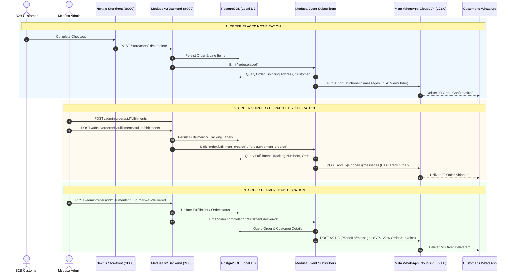
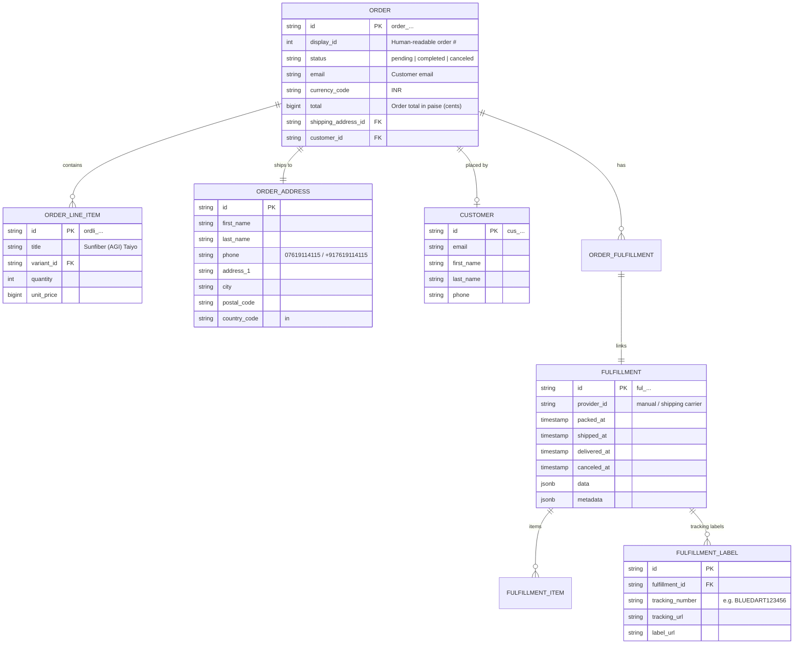

# WhatsApp Notification System Architecture

Comprehensive documentation of the automated WhatsApp notification system integrated into IngredientsBazar Medusa v2 B2B platform.

---

## 1. Overview & Architecture

The system listens to core Medusa lifecycle events (Order Placement, Fulfillment/Shipment, and Delivery) and automatically triggers interactive, branded WhatsApp messages via Meta Cloud API v21.0 to the customer's phone number with actionable CTA links (e.g. *View Order Details*, *Track Order*, *Invoice*).



---

## 2. Trigger Endpoints & Lifecycle Events

### A. Storefront Endpoints (Customer Facing)
| HTTP Method | Route | Description | Emitted Event |
|---|---|---|---|
| `POST` | `/store/carts/:id/complete` | Finalizes cart payment and creates order | `order.placed` |

### B. Admin API Endpoints (Operations / Fulfillment)
| HTTP Method | Route | Description | Emitted Events |
|---|---|---|---|
| `POST` | `/admin/orders/:id/fulfillments` | Creates fulfillment for order line items | `order.fulfillment_created`, `fulfillment.created` |
| `POST` | `/admin/orders/:id/fulfillments/:ful_id/shipments` | Creates tracking shipment for fulfillment | `order.shipment_created`, `fulfillment.shipment_created`, `order.shipped` |
| `POST` | `/admin/orders/:id/fulfillments/:ful_id/mark-as-delivered` | Marks shipment as delivered | `fulfillment.delivered`, `order.fulfillment_delivered` |
| `POST` | `/admin/orders/:id/complete` | Marks order completed | `order.completed`, `order.delivered` |

### C. External Meta Cloud API Endpoints
| HTTP Method | URL | Payload Type | Description |
|---|---|---|---|
| `POST` | `https://graph.facebook.com/v21.0/{WHATSAPP_PHONE_NUMBER_ID}/messages` | `interactive` (`cta_url` / `button`) | Sends direct interactive WhatsApp message |
| `GET` | `https://graph.facebook.com/v21.0/oauth/access_token` | Query Params: `grant_type=fb_exchange_token`, `client_id`, `client_secret` | Exchanges short-lived token for long-lived 60-day token |

---

## 3. Database Schema & Tables Used

Medusa v2 uses modular DML tables in PostgreSQL. The notification system queries the following tables via Medusa Remote Query (`query.graph`):



### Table Details:
1. **`order`**: Root order record. Stores order ID (`order_01...`), sequential display ID (`#1042`), total price, and status.
2. **`order_address`**: Physical delivery address. Primary source for customer recipient phone number (`shipping_address.phone`).
3. **`customer`**: Account profile. Fallback source for customer phone (`customer.phone`).
4. **`fulfillment`**: Fulfillment batch created by warehouse/admin (`ful_01...`).
5. **`fulfillment_label`**: Houses carrier tracking numbers (`tracking_number`) and external tracking links (`tracking_url`).
6. **`order_fulfillment`**: Relational link table mapping Medusa Orders to Fulfillments.
7. **`order_line_item`**: Line items, quantities, and product names included in the order.

---

## 4. Subscribers & Logic Implementation

### 1. Order Placed Subscriber
- **File**: `apps/backend/src/subscribers/order-placed-whatsapp.ts`
- **Trigger**: `order.placed`
- **Data Resolution**:
  ```ts
  const { data: orders } = await query.graph({
    entity: "order",
    fields: [
      "id",
      "display_id",
      "email",
      "currency_code",
      "total",
      "shipping_address.*",
      "customer.*",
    ],
    filters: { id: orderId },
  })
  ```
- **Message Content**:
  - Header: `🎉 Order Confirmation`
  - Body: Personalized greeting with Order `#display_id`, processing status, and storefront review link.
  - Action CTA: **"View Order Details"** $\rightarrow$ `https://storefront-url/in/order/:id/confirmed`

---

### 2. Order Shipped / Dispatched Subscriber
- **File**: `apps/backend/src/subscribers/order-dispatched-whatsapp.ts`
- **Triggers**: `order.fulfillment_created`, `fulfillment.created`, `order.shipment_created`, `fulfillment.shipment_created`, `order.shipped`, `fulfillment.shipped`
- **Data Resolution**:
  - Handles direct order event or fulfillment event (`data.id.startsWith("ful_")`).
  - Resolves linked order and extracts tracking numbers from `order.fulfillments.labels`.
- **Message Content**:
  - Header: `🚚 Order Shipped`
  - Body: Dispatched notification with tracking numbers if present (`📦 Tracking #: BLUEDART...`).
  - Action CTA: **"Track Order"** $\rightarrow$ `https://storefront-url/in/order/:id/confirmed`

---

### 3. Order Delivered Subscriber
- **File**: `apps/backend/src/subscribers/order-delivered-whatsapp.ts`
- **Triggers**: `order.completed`, `order.delivered`, `fulfillment.delivered`, `order.fulfillment_delivered`
- **Message Content**:
  - Header: `✅ Order Delivered`
  - Body: Delivery confirmation and customer support feedback prompt.
  - Action CTA: **"View Order & Invoice"** $\rightarrow$ `https://storefront-url/in/order/:id/confirmed`

---

## 5. Phone Normalization (E.164 Standard)

The helper in `apps/backend/src/lib/whatsapp.ts` automatically converts Indian local formats to Meta E.164:
- Local leading `0`: `07619114115` $\rightarrow$ `917619114115`
- 10-digit number: `7619114115` $\rightarrow$ `917619114115`
- International: `+917619114115` $\rightarrow$ `917619114115`

```ts
export function normalizePhoneNumber(rawPhone: string, defaultCountryCode = "91"): string {
  if (!rawPhone) return ""
  let cleaned = rawPhone.replace(/[^\d+]/g, "")
  if (cleaned.startsWith("+")) cleaned = cleaned.substring(1)
  if (cleaned.startsWith("0") && cleaned.length === 11) {
    cleaned = cleaned.substring(1)
  }
  if (cleaned.length === 10) {
    cleaned = `${defaultCountryCode}${cleaned}`
  }
  return cleaned
}
```

---

## 6. Meta Cloud API Payload Structure

Messages are dispatched as interactive CTA buttons:

```json
{
  "messaging_product": "whatsapp",
  "recipient_type": "individual",
  "to": "917619114115",
  "type": "interactive",
  "interactive": {
    "type": "cta_url",
    "header": {
      "type": "text",
      "text": "🚚 Order Shipped"
    },
    "body": {
      "text": "Hi Manoj Kumar,\n\nGreat news! Your IngredientsBazar order #8 has been shipped and is on its way to you.\n📦 Tracking #: AWB987654321\n\nClick the button below to track your live shipment."
    },
    "footer": {
      "text": "IngredientsBazar Logistics"
    },
    "action": {
      "name": "cta_url",
      "parameters": {
        "display_text": "Track Order",
        "url": "https://storefront-snowy-iota.vercel.app/in/order/order_01M43TTD304DSRSA81Y7NZAJXY/confirmed"
      }
    }
  }
}
```

---

## 7. Environment Variables Configuration

In `apps/backend/.env`:

```ini
# WhatsApp Meta Cloud API
WHATSAPP_PHONE_NUMBER_ID=<your-whatsapp-phone-number-id>
WHATSAPP_BUSINESS_ACCOUNT_ID=<your-whatsapp-business-account-id>
WHATSAPP_ACCESS_TOKEN=<your-whatsapp-access-token>
STOREFRONT_URL=<your-storefront-url>
META_APP_ID=<your-meta-app-id>
META_APP_SECRET=<your-meta-app-secret>
```
